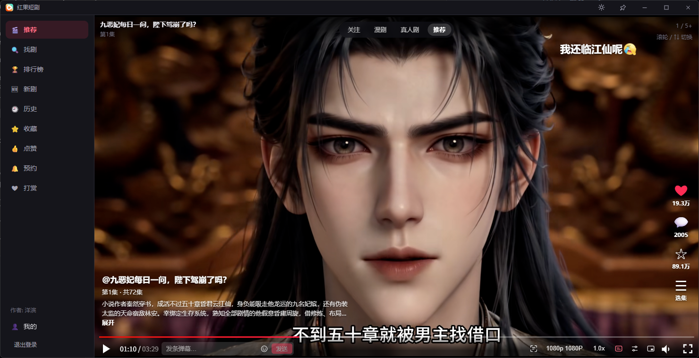
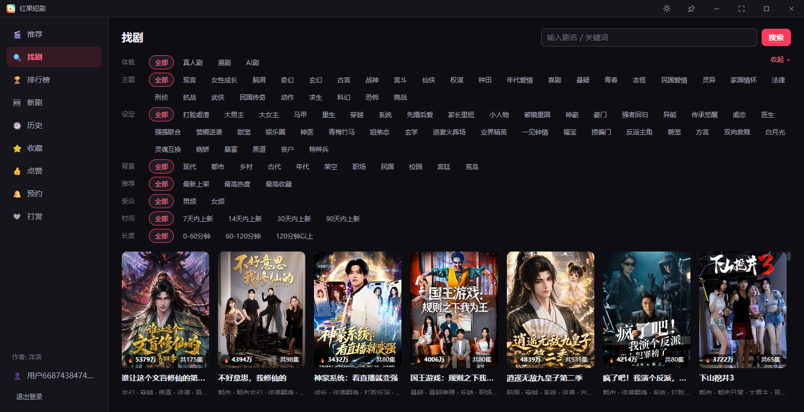
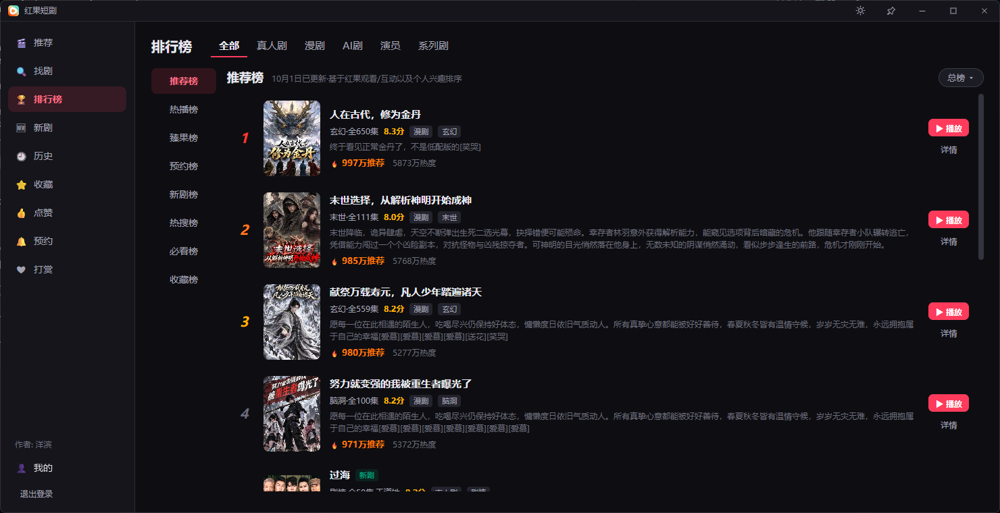
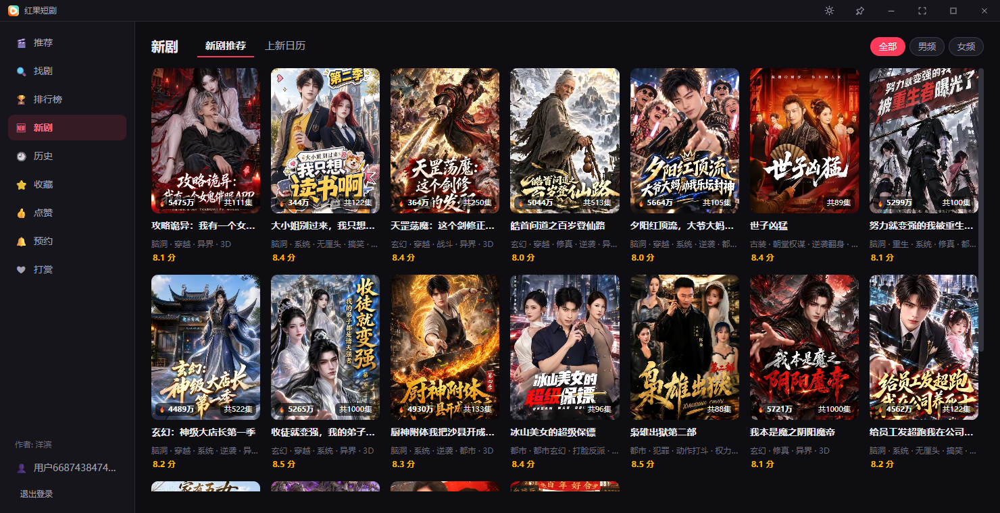
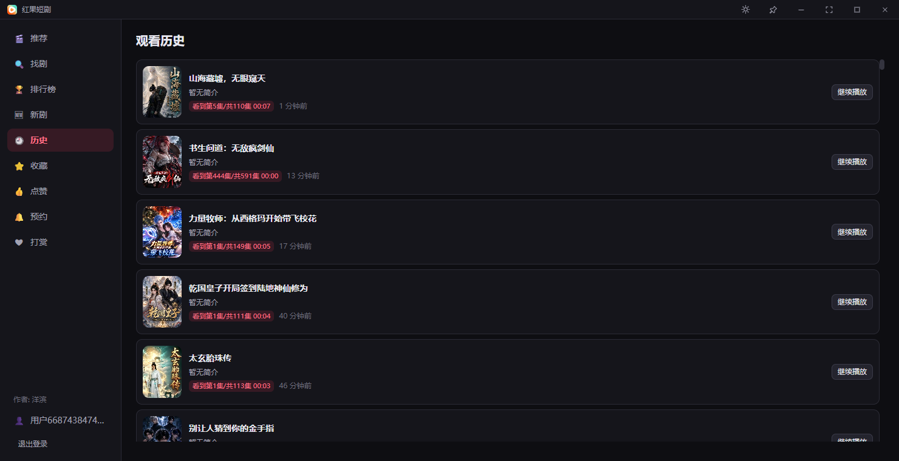
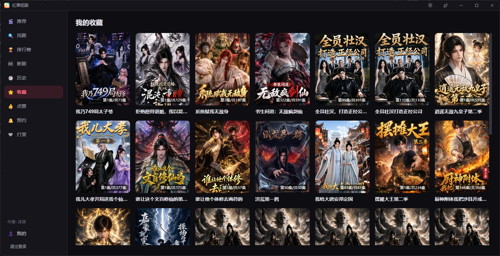
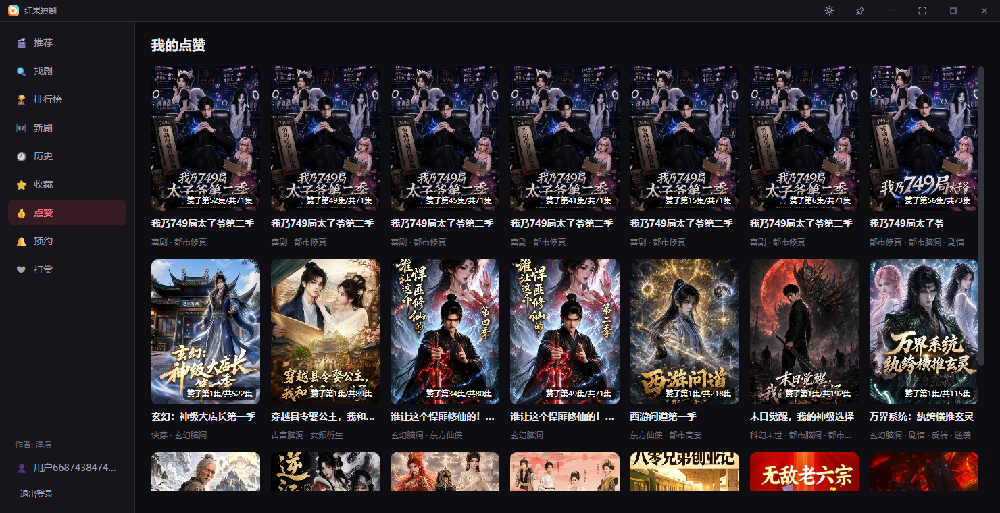
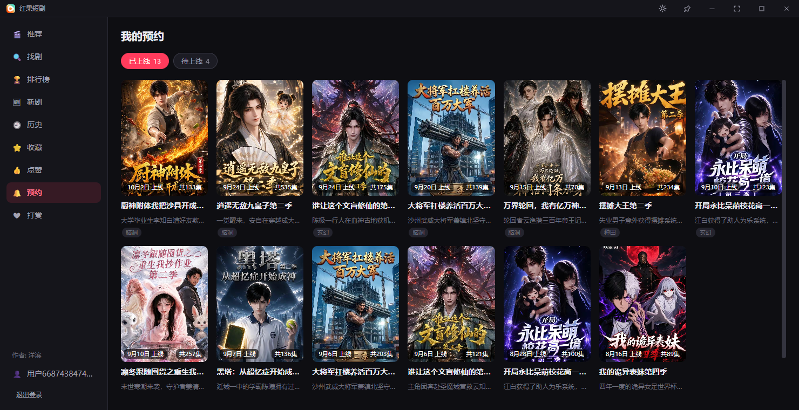

<div align="center">

# 红果短剧电脑版

### 不用安卓模拟器，直接在 Windows / macOS 上刷红果短剧

专为电脑设计的红果短剧桌面客户端

**沉浸式刷剧 · 自动连播 · 竖屏模式 · 追更提醒 · 弹幕评论 · 小窗模式 · 搜索与排行榜**

**[⬇️ Windows 下载](https://hongguo.235698.xyz/download/latest/windows-amd64)**　　**[🍎 macOS 下载](https://hongguo.235698.xyz/download/latest/darwin-universal)**

Windows 10 / 11 (64 位) · macOS (Intel 与 Apple 芯片通用) · 免费无广告

下载页 (国内可直接打开): **https://hongguo.235698.xyz** · 也可以到 [Releases](../../releases/latest) 下载

打不开上面的链接? 用蓝奏云 (无需密码): **[wwalp.lanzout.com/b0rbj88ji](https://wwalp.lanzout.com/b0rbj88ji)**



</div>

## 🖥️ 为什么做这个?

手机刷短剧很方便. 但已经坐在电脑前的时候, 为了看几集还要拿起手机, 或者专门开一个安卓模拟器, 多少有点麻烦.

所以做了这个真正适合电脑用的红果短剧客户端: 鼠标滚轮刷剧, 方向键切换, 看完自动下一集, 还能开个小窗边工作边追剧.

## ✨ 主要功能

- 🎬 **沉浸式刷剧**: 推荐 / 分类刷剧, 鼠标滚轮或方向键切换, 边刷边预加载
- ▶️ **自动连播**: 看完自动播放下一集、下一季, 记住上次看到哪
- 🔍 **找剧方便**: 搜索 (带输入联想)、多维度筛选 (含已完结 / 连载中)、排行榜、新剧推荐与上新日历
- 📌 **追更提醒**: 追的剧更新了、预约的剧上线了, 打开程序就提醒你
- 📱 **竖屏模式**: 竖屏短剧时窗口收窄到刚好包住画面, 不留两侧黑边
- ✨ **画质**: 默认最高画质, 可开画质增强 (锐化 / 漫剧动漫增强 Anime4K); 画面和窗口比例接近时自动铺满
- 💬 **互动**: 弹幕 (点赞 / 回复 / +1)、评论 (在画面右侧展开) 与剧评, 和手机端互通
- ❤️ **追剧管理**: 收藏、点赞 (可按真人剧 / 漫剧 / AI剧筛选)、观看历史、预约, 都能搜索和批量删除
- ⌨️ **键盘快捷键**: 默认与抖音网页版一致, 可以自己改
- 🪟 **小窗模式**: 窗口置顶, 边工作边追剧; 隐身模式下鼠标移开自动暂停隐藏
- 🙈 **干净的画面**: 鼠标不动时控制条、点赞栏自动隐藏, 全屏看剧不挡画面
- 🔗 **分享**: 一键复制分享链接 (手机红果 App 可直接打开); 复制别人的分享链接后自动识别播放
- 💻 **Windows + macOS**: Mac 同时支持 Intel 与 Apple 芯片
- ⚡ **解码兜底**: 硬件解码不可用时自动改用软件解码, 不会只有声音没有画面
- 🔄 **自动更新**、浅色 / 深色主题

## 📸 界面预览

| 找剧 | 排行榜 |
|---|---|
|  |  |
| **新剧** | **观看历史** |
|  |  |
| **我的收藏** | **我的点赞** |
|  |  |
| **我的预约** | |
|  | |

## 📥 下载与安装

| 系统 | 下载 | 文件 |
|---|---|---|
| Windows 10 / 11 (64 位) | [下载 Windows 版](https://hongguo.235698.xyz/download/latest/windows-amd64) | `hongguo-版本号-windows-amd64.zip` |
| macOS (Intel 与 Apple 芯片通用) | [下载 macOS 版](https://hongguo.235698.xyz/download/latest/darwin-universal) | `hongguo-版本号-macos-universal.zip` |

下载慢或打不开, 可以到本仓库的 [Releases](../../releases/latest), 或者蓝奏云目录 [wwalp.lanzout.com/b0rbj88ji](https://wwalp.lanzout.com/b0rbj88ji) (无需密码) 下载同样的文件. 蓝奏云目录里有全部版本, 新版本发布后会自动放进去.

**Windows**

1. 下载压缩包, **解压到一个文件夹**后双击 `红果短剧.exe`, 无需安装. 压缩包里还有:
   - `MicrosoftEdgeWebview2Setup.exe`: WebView2 运行时安装程序
   - `HEVC视频扩展-双击安装.appx`: HEVC 视频扩展
   - `使用说明.txt`

   请和程序放在一起: 首次运行如果系统缺少 **WebView2 运行时** 或 **HEVC 视频扩展**, 程序会用它们自动安装 (WebView2 需要联网).
2. 若提示 "Windows 已保护你的电脑", 点 **更多信息 → 仍要运行** (程序没有购买代码签名证书).
3. 以后有新版本时程序会提示, 点 "立即重启更新" 即可自动更新 (只替换 `红果短剧.exe`).

> Releases 里的 `hongguo-版本号-windows-amd64.exe` 是主程序本身, 供自动更新使用; 新安装请下载 zip.

**macOS**

1. 解压得到 `红果短剧.app`, 拖到 "应用程序".
2. 应用未签名, 首次打开如提示 "已损坏" 或 "无法验证开发者", 在终端执行:
   ```
   xattr -cr /Applications/红果短剧.app
   ```
   然后再打开.

## ❓ 常见问题

**需要登录吗? 要钱吗?**

免费, 不登录也能刷剧; 收藏、点赞、观看历史未登录时保存在本机. 用手机号登录后与手机端红果 App 同步.

**杀毒软件报毒 / 程序被删了?**

是**误报**. 本程序没有购买代码签名证书, 新版本刚发布时也还没有 "信誉", 再加上自动更新会替换自己的程序文件, 这些行为容易被安全软件的机器学习规则 (如 Windows 安全中心的 `!ml`) 当成可疑程序. 程序不会收集你的账号密码, 也不会改系统设置.

- **Windows 安全中心**: 打开 "病毒和威胁防护" › "保护历史记录", 找到被拦的红果短剧点 **还原 / 允许**; 再到 "病毒和威胁防护设置" › "排除项" › **添加排除项 › 文件夹**, 选择程序所在的文件夹.
- **360 安全卫士**: 木马查杀 › 右下角 **恢复区** 里恢复, 再到 **信任区** 添加程序所在文件夹.
- **火绒**: 隔离区里恢复, 再在 "信任区" 添加程序文件夹.
- 建议把程序放在**单独的文件夹** (如 `D:\红果短剧\`), 不要直接放桌面或 D 盘根目录, 方便加排除项; 加了排除项后, 以后自动更新出来的新版本也不会再被删.

**提示 "获取播放地址失败: 服务端返回了空内容" / 突然播放不了?**

红果的接口经常调整, 旧版本可能突然就播不了了, 请**更新到最新版**: 程序内 设置 › 关于与更新 › 检查更新, 或到上面的下载页 / 蓝奏云下载最新的 zip. 更新到最新版还不行, 请在程序里点 "反馈" 告诉我们.

**提示 "设备自动注册失败" / "后端未就绪"?**

程序首次启动要向红果注册一个设备, 连不上红果服务器时就会这样, 一般是网络环境的问题:

1. 先关掉 **VPN / 代理 / 加速器**, 再点重试.
2. 用了**广告过滤**软件, 或路由器 / 自定义 DNS (如 AdGuard) 的, 请把 `log.snssdk.com`、`snssdk.com` 加入白名单. 1.2.22 起被 DNS 拦截时会自动改用公共 DNS 绕过去.
3. 公司 / 学校网络可能拦截了这些域名, 换个网络 (如手机热点) 试试.

**只有声音, 没有画面? 清晰度只有 1080p 一档?**

1.1.5 起硬件解码不可用时会自动改用软件解码, 一般不会再出现; 旧版本请先更新. 1.2.20 / 1.2.21 有的剧只有 1080p 一档、个别剧只有声音, 1.2.22 已修复. 仍有问题可按下面排查:

1. 点播放器提示条上的 **"重启程序"**. HEVC 视频扩展刚装上或被微软商店更新后, 要重启程序才能生效.
2. 仍不行就**重启电脑**再试.
3. 扩展自动安装失败时, 双击程序目录里的 `HEVC视频扩展-双击安装.appx` 手动安装.
4. 远程桌面 / 虚拟机通常没有显卡硬件解码, 会使用软件解码 (CPU 占用较高); 画面花屏 / 黑屏时可在播放器的设置面板 (控制条上的齿轮) 里勾选 "软件解码".

**播放卡顿 / 转圈 / 画面一卡一卡?**

1. 网络慢时降低清晰度 (控制条上的清晰度).
2. 开了**画质增强** (锐化 / 动漫增强) 的, 先关掉试试; 核显跑 Anime4K "高" 档压力很大, 可以改成 "快".
3. 设置面板 › 解码 一行会显示当前用的解码方式: 软件解码时电脑忙不过来会卡, 可以试试切换 "软件解码方式", 或关掉其它占 CPU 的程序.
4. 笔记本 / 双显卡电脑见下一条.

**双显卡: 画面卡住、声音照走 / 想指定用哪块显卡?**

硬件解码和画质增强在 WebView2 (Edge 网页组件) 里进行, Windows "图形设置" 或 NVIDIA 控制面板里给 `红果短剧.exe` 指定的显卡管不到它. 1.2.22 起, 电脑有两块以上显卡时, 播放器设置面板 › 解码 里有 **"画面用的显卡"**:

- **自动** (默认): 先按 Windows 图形设置里给本程序选的 节能 / 高性能 来选, 没选过就用接着显示器的那块 (笔记本一般是核显, 把独显设成全局首选也不会再卡);
- 也可以直接指定某块显卡 (比如让画质增强用更强的独显). 改完点 "重启" 生效.

**多显示器: 一边打游戏 / 用别的程序, 另一块屏幕上播放卡顿、音画不同步?**

在主屏玩游戏 (或点了别的窗口), 副屏上的画面卡、声音和画面对不上, 只移动鼠标不点就没事 (感谢 #157 的测试者提供办法):

1. 打开 Windows **设置 › 系统 › 屏幕 › 显示卡** (Windows 10: 设置 › 系统 › 显示 › 图形设置)
2. 点 **高级图形设置** (或 "更改默认图形设置")
3. 关闭 **硬件加速 GPU 调度**, 关闭 **可变刷新率**, 然后重启电脑

还卡的话, 可以关掉 "画质增强" 减轻显卡负担.

**窗口跑到屏幕外面, 找不到了?**

多显示器时退出小窗 / 竖屏, 旧版本可能把窗口放到屏幕外 (1.2.22 已修复). 找回办法: 按 **Alt + 空格**, 再按 **M**, 然后按任意方向键, 移动鼠标就能把窗口拖回来; 或者按 **Win + Shift + ← / →** 把窗口移到另一块屏幕.

**检查更新显示 "已是最新" / 更新失败 / 更新后程序不见了?**

- 很旧的版本 (1.2.3 以前) 检查更新可能显示已是最新, 请直接到下载页或蓝奏云下载最新的 zip, 解压覆盖原来的文件夹即可 (设置和登录状态都会保留).
- 连不上更新服务器时, 程序会改从蓝奏云检查更新.
- 更新后程序 (`红果短剧.exe`) 不见了, 基本是被安全软件删了, 见上面 "杀毒软件报毒".

**重新打开程序又要登录?**

旧版本有这个问题, 已修复, 请更新到最新版. 如果数据目录放在内存盘 / 会被清理的位置, 也会丢失登录状态, 可以在 设置 › 数据与缓存 里改到别的盘.

**下载的视频用别的播放器打不开 / 提示文件损坏?**

红果的视频是**加密**的, 下载下来的文件只能在本软件的 "下载" 页里播放 (没网也能看), 用 VLC 等其它播放器打不开是正常的.

**数据和缓存放在哪? 能改位置吗?**

默认在 `%APPDATA%\hgplayer` (Mac: `~/Library/Application Support/hgplayer`), 包括登录状态、缓存和下载的视频. 可以在 设置 › 数据与缓存 里改到别的盘, 程序会自动搬过去.

**提示 "无法连接本地播放服务"?**

程序在本机 (127.0.0.1) 起一个小服务给播放器送视频, 不连外网. 被防火墙或安全软件拦了就会这样: 按提示点 **一键放行** (需要管理员确认),
或在 Windows 防火墙 "允许应用通过防火墙" 里勾选 `红果短剧.exe`; 360 / 火绒等安全软件请把本程序加入信任列表.

**遇到问题怎么反馈?**

在程序左侧点 **"反馈"** 提交 (可留邮箱, 解决后通知你; 作者回复后可以接着对话), 或到本仓库提 [Issue](../../issues), 也可以加 QQ 联系作者. 反馈时写上版本号 (设置 › 关于与更新) 和出问题的剧名 / 第几集, 能更快找到原因.

## ⚠️ 说明

本项目为个人开发的**非官方**第三方客户端, 与红果短剧官方无关. 仅供个人学习交流, 免费分享, 禁止倒卖.

本仓库只用于发布安装包, 不包含源代码.

## 👤 联系作者

- 作者: 洋滨
- 邮箱: yangbin1322@gmail.com
- QQ: 3177762472

## ⭐ 如果对你有帮助

欢迎点个 Star ⭐, 也欢迎分享给身边爱看短剧的朋友 —— 对个人开发者继续维护是很大的鼓励. 也可以在软件的 "打赏" 页面支持作者 ❤
